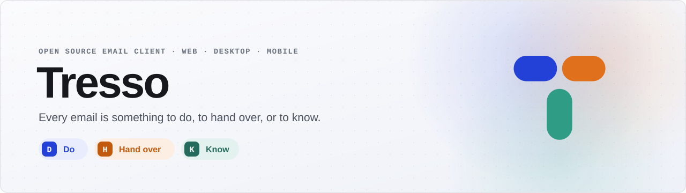
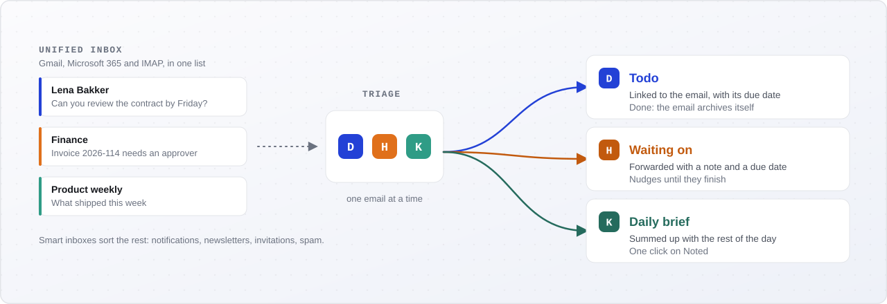

<div align="center">

<picture>
  <source media="(prefers-color-scheme: dark)" srcset="assets/banner-dark.svg">
  
</picture>

<br>

<a href="https://github.com/gettresso/tresso/actions/workflows/ci.yml"></a>
<a href="https://github.com/gettresso/tresso/actions/workflows/release.yml"></a>
<a href="https://github.com/gettresso/tresso/releases/latest"></a>
<a href="LICENSE"></a>


**Tresso** is an open source email client built around a single idea: every email is something to **do**, to **hand over**, or to **know**.<br>
Repo: [github.com/gettresso/tresso](https://github.com/gettresso/tresso)

[Install](#-install) · [How it works](#-how-it-works) · [Highlights](#-highlights) · [Your own server](#-your-own-server) · [Development](#-development) · [Releases](#-releases)

</div>

<br>

## 📦 Install

The desktop app runs on macOS, Linux and Windows. It signs in to Tresso Cloud, or to [your own server](#-your-own-server).

### macOS / Linux

```bash
curl -fsSL https://sherin.dev/tresso/install.sh | bash
```

Pin a release with `bash -s`:

```bash
curl -fsSL https://sherin.dev/tresso/install.sh | bash -s v0.1.0
```

On macOS the script puts `Tresso.app` in `/Applications` (or `~/Applications` when that is not writable). On Linux it installs the AppImage in `~/.local/share/tresso`, links `tresso` into `~/.local/bin`, and adds a launcher entry that also opens `tresso://` links, through which sign-in comes back. `TRESSO_VERSION` pins a release like the first argument, and `TRESSO_INSTALL` picks another folder. Run it again to upgrade in place.

### Windows

```powershell
powershell -c "irm https://sherin.dev/tresso/install.ps1|iex"
```

The script runs the installer silently for your user: Tresso goes to `%LOCALAPPDATA%\Tresso` and into the Start menu. `$env:TRESSO_VERSION` pins a release (`v0.1.0`). Remove it again under **Settings > Apps**.

Both scripts check the download against `SHA256SUMS` on the GitHub release before they install anything.

After that, Tresso keeps itself up to date. On macOS it uses [Sparkle](https://sparkle-project.org): it checks every few hours, and **Tresso > Check for Updates…** asks right away. On Windows and Linux (the AppImage) a card offers the new version. Every update is signed, and the app installs only updates whose signature matches the key built into it. **Settings > Updates** shows your version.

<details>
<summary><b>Published files</b></summary>

<br>

Every [release](https://github.com/gettresso/tresso/releases) has:

| Platform                       | File                                                                 |
| ------------------------------ | -------------------------------------------------------------------- |
| macOS (Apple Silicon and Intel) | `tresso-macos-universal.dmg`, `tresso-macos-universal.app.tar.gz`   |
| Linux x86_64                   | `tresso-linux-x86_64.AppImage`, `tresso-linux-x86_64.deb`            |
| Linux arm64                    | `tresso-linux-aarch64.AppImage`, `tresso-linux-aarch64.deb`          |
| Windows x64                    | `tresso-windows-x64-setup.exe`, `tresso-windows-x64.msi`             |

Prereleases (`v1.2.0-beta.1`) ship the Windows setup without the `.msi`, which only takes numeric versions.

The app is not signed with an Apple Developer ID yet. The install script lifts the macOS quarantine for you. When you open the `.dmg` yourself, right-click Tresso and choose **Open** the first time, or run `xattr -dr com.apple.quarantine /Applications/Tresso.app`. The AppImage needs FUSE 2 (`libfuse2`, or `libfuse2t64` on Ubuntu 24.04 and later); the `.deb` does not.

</details>

## 🧭 How it works

<picture>
  <source media="(prefers-color-scheme: dark)" srcset="assets/how-it-works-dark.svg">
  
</picture>

| Verdict | What happens | Done when |
|---|---|---|
| **Do** | It becomes a todo, linked to the email, with a due date when there is one | The todo is completed and the email archives itself |
| **Hand over** | It goes to someone else with a note and a due date | They finish it; until then it sits in *Waiting on* |
| **Know** | It lands in the daily brief | One click on *Noted* |

## ✨ Highlights

- **Unified Inbox** across all your accounts, grouped into smart inboxes (To do, Informational, Notifications,
  Newsletters, Invitations, Spam) plus your own, defined by a name, instructions and sender include/exclude lists.
- **Built-in todos** that sync across devices, can be created automatically from email, and get time in your calendar.
- **Triage mode**: one email at a time, settled with D, H or K.
- **Calendar** next to your mail: invitations answered from the email, events from what an email proposes.
- **One account, every device**: settings, mail accounts and HTML signatures stay in sync.
- **Attachment virus scanning** before anything can be opened, and your mail encrypted at rest per user.
- **Everywhere**: web, desktop (Tauri) and mobile (Expo), with notifications only for mail that needs you.

## 🔓 Open source and Tresso Cloud

Tresso is fully open source. Everything it does is in this repository, and running it on your own server is free,
with every feature. What is still on the [roadmap](docs/ROADMAP.md), such as AI with your own key or endpoint, teams
with shared inboxes, API keys, webhooks and an MCP endpoint, lands here too.

**Tresso Cloud** is the managed hosting of that same code: a subscription pays for running it for you, with backups
and support, never for features. See [Self-hosted and Tresso Cloud](docs/ARCHITECTURE.md#self-hosted-and-tresso-cloud).

## 🏠 Your own server

Every release publishes the server as images on GitHub's container registry: `ghcr.io/gettresso/tresso-api` (the API
and its workers), `tresso-sync` (the sync workers) and `tresso-web` (the web client), for amd64 and arm64. Tresso Cloud
runs the same images. To run them, you need a server with Docker, two DNS names pointing at it (one for the web
client, one for the API) and ports 80 and 443 open:

1. Download [`compose.prod.yaml`](compose.prod.yaml) and [`.env.prod.example`](.env.prod.example) into one folder.
2. Copy `.env.prod.example` to `.env` and fill it in: your two addresses, `CORS_ALLOW_ORIGIN` with your web address
   in it, and every secret, each generated (`openssl rand -hex 32`). Keep a copy of `DATA_KEYS` somewhere safe: it
   encrypts the mail at rest, and losing it loses that mail. The API refuses to start while a secret is missing, too
   short, or one of the development values in this repository, or while an address or `CORS_ALLOW_ORIGIN` is wrong.
3. Start it:

   ```bash
   docker compose -f compose.prod.yaml --env-file .env up -d
   ```

4. Create your account:

   ```bash
   docker compose -f compose.prod.yaml exec api php bin/console app:user:create you@example.com "Your Name"
   ```

The stack gets HTTPS certificates by itself, migrates the database on start and runs PostgreSQL, Redis, object
storage (RustFS), Meilisearch and ClamAV next to Tresso; ClamAV needs about 1.5 GB of RAM. To upgrade, set
`TRESSO_VERSION` (or keep `latest`) and run `docker compose -f compose.prod.yaml pull` before `up -d`. Two settings
only apply the first time: `POSTGRES_PASSWORD` (the database keeps its password) and `OAUTH_PASSPHRASE` (it encrypts
the OAuth signing key; a new one needs a new key, which signs everyone out).

Running the images without this compose file, set the same settings as `compose.prod.yaml` does. The API container
needs `RUN_MIGRATIONS=1` to migrate and create the OAuth clients (or run `php bin/console app:oauth:bootstrap-clients`
once), and the desktop app's origins, `tauri://localhost` and `http://tauri.localhost`, belong in both
`CORS_ALLOW_ORIGIN` and `MERCURE_CORS_ORIGINS`.

In the desktop app, choose **Use another server** on the sign-in screen and enter the API address, such as
`api.mail.example.com`. The app checks that the server answers and remembers it until you choose again. The web
client is at your web address.

## 🧱 Stack

| Part | Technology |
|---|---|
| API | PHP 8.5, Symfony 8.1 on FrankenPHP (worker mode), Doctrine, Messenger, OAuth2 server |
| Sync workers | Go 1.27 |
| Web | Vue 3, Vite, TypeScript, Pinia |
| Desktop | Tauri 2 (Rust) wrapping the web app |
| Mobile | Expo (React Native) |
| Data | PostgreSQL 18, Redis, S3 storage (RustFS locally), Meilisearch |
| Scanning | ClamAV |

## 📁 Repository

```
apps/
  api/        Symfony API: OAuth2 server, domain, background jobs
  sync/       Go sync workers
  web/        Vue 3 web client
  desktop/    Tauri 2 shell around apps/web
  mobile/     Expo app
packages/
  core/       Shared TypeScript: domain types, OAuth2 PKCE client
docker/       Dockerfiles and server config
docs/         Architecture and roadmap
scripts/      Install scripts for the desktop app
assets/       README images
```

## 🚀 Getting started

You need Docker, Node 24 or newer, and Rust for the desktop app. Go and PHP run inside containers.

1. Start the stack:

   ```bash
   docker compose up -d
   ```

   On first boot the API installs its dependencies, generates OAuth2 signing keys, runs the migrations and creates
   the first-party OAuth2 clients (`web`, `desktop`, `mobile`, `sync-worker`).

2. Create a user (you are asked for a password):

   ```bash
   docker compose exec api php bin/console app:user:create you@example.com "Your Name"
   ```

3. Install the JavaScript workspaces and start the web app:

   ```bash
   npm install
   ```

   ```bash
   npm run dev:web
   ```

   Open http://localhost:5173 and sign in.

The desktop and mobile apps start with:

```bash
npm run dev:desktop
```

```bash
npm run dev:mobile
```

### Gmail and Microsoft 365

Connecting Gmail and Microsoft 365 accounts needs an OAuth app at Google and at Microsoft, registered by whoever runs
the server. [docs/ARCHITECTURE.md](docs/ARCHITECTURE.md#registering-the-oauth-apps) lists the steps. In short:

- Redirect URIs: `http://localhost:8080/connect/google/callback` and `http://localhost:8080/connect/microsoft/callback`
  for the Docker stack (`<API_PUBLIC_URL>/connect/<provider>/callback` elsewhere).
- Scopes: Google `openid email profile https://www.googleapis.com/auth/gmail.modify` (with the Gmail API enabled);
  Microsoft Graph delegated `openid email profile offline_access User.Read Mail.ReadWrite Mail.Send`.
- Put the client ids and secrets in `apps/api/.env.local`:

  ```dotenv
  GOOGLE_OAUTH_CLIENT_ID=...
  GOOGLE_OAUTH_CLIENT_SECRET=...
  MICROSOFT_OAUTH_CLIENT_ID=...
  MICROSOFT_OAUTH_CLIENT_SECRET=...
  MICROSOFT_OAUTH_TENANT=common
  ```

Without them the web app only offers IMAP accounts.

### Local services

| Service | Address |
|---|---|
| API | http://localhost:8080 (health check at `/health`) |
| Web app | http://localhost:5173 |
| Mailpit (outgoing mail) | http://localhost:8025 |
| RustFS (S3) | http://localhost:9000, console on 9001 |
| Meilisearch | http://localhost:7700 |
| Postgres | `localhost:54320` (user, password and database: `app`) |
| Redis | `localhost:63790` |
| GreenMail (test mail server) | IMAP `localhost:3143`, IMAPS 3993, SMTP 3025, SMTPS 3465 |

The sync worker in the dev stack has `MAIL_ALLOW_UNSAFE_SERVERS=1` so it can reach GreenMail on the Docker network;
in production that must stay off. The integration tests empty the `kim@tresso.test` mailbox.

GreenMail has two mailboxes for development, `kim@tresso.test` (password `dev-password-kim`) and `lisa@tresso.test`
(`dev-password-lisa`). Connect them in the app with host `greenmail`, IMAP port 3143 and SMTP port 3025, security
`none`.

ClamAV needs about 1.5 GB of memory, so it only starts when asked. `CLAMAV_HOST` points the API at it; without it,
attachments are marked as not scanned and open only after a warning. `ATTACHMENTS_REQUIRE_SCAN=1` removes that
override (and then needs a scanner: the health check fails without one). Scans run in their own worker, `scanner`.

```bash
CLAMAV_HOST=clamav docker compose --profile scan up -d
```

After a signature update, or once clamd is back after scans failed, scan attachments again with
`php bin/console app:attachments:rescan --all` (or `--user=<email>`, optionally `--status=failed`).

## 🔧 Development

Create the test database once:

```bash
docker compose exec -e APP_ENV=test api sh -c 'php bin/console doctrine:database:create --if-not-exists && php bin/console doctrine:migrations:migrate -n'
```

Then run the checks for the part you changed:

| Part | Command |
|---|---|
| API tests (per file) | `docker compose exec -e APP_ENV=test api php bin/phpunit tests/Functional/SyncLeaseTest.php` |
| API static analysis | `docker compose exec api sh -c 'bin/console cache:warmup --env=test && vendor/bin/phpstan analyse'` |
| API docs (dev only) | http://localhost:8080/docs |
| Sync worker | `docker run --rm -v "$PWD/apps/sync":/src -w /src golang:1.27 go test -race ./...` |
| Sync worker against GreenMail | `docker run --rm --network tresso_default -e GREENMAIL_HOST=greenmail -v "$PWD/apps/sync":/src -w /src golang:1.27 go test -race -tags integration ./...` |
| Shared core | `npm test --workspace @tresso/core` |
| Web | `npm run test:unit --workspace @tresso/web` and `npm run type-check --workspace @tresso/web` |
| Desktop | `cargo check` in `apps/desktop/src-tauri` (on macOS first `node apps/desktop/scripts/fetch-sparkle.mjs`, which the Tauri commands also run) |
| Mobile | `npx vitest run`, `npx tsc --noEmit` and `npx expo lint` in `apps/mobile` |

Every push and pull request runs all of these in [CI](.github/workflows/ci.yml).

Commits follow [Conventional Commits](https://www.conventionalcommits.org/) with a required scope from
[`.agents/commit-scopes.md`](.agents/commit-scopes.md), for example `feat(api): add todo endpoints`.

### Good to know

- FrankenPHP keeps the app in memory. After clearing the cache inside the container, restart it with
  `docker compose restart api`.
- After `compose.yaml` changes (new environment variables, for example), recreate the services with
  `docker compose up -d`: `restart` keeps a container's old environment.
- Secrets in `compose.yaml` and the committed `.env` files are development values only. Real secrets go in
  `.env.local` files or the deployment environment. In production set at least `APP_SECRET`, `OAUTH_PASSPHRASE`,
  `OAUTH_ENCRYPTION_KEY`, `SYNC_WORKER_CLIENT_SECRET`, `DATA_KEYS` and `DATA_KEY_CURRENT`, the Mercure hub
  settings (`MERCURE_PUBLIC_URL`, `MERCURE_INTERNAL_URL`, `MERCURE_CORS_ORIGINS` and two different keys of at least
  32 bytes in `MERCURE_PUBLISHER_JWT_KEY` and `MERCURE_SUBSCRIBER_JWT_KEY`), the object storage settings
  (`S3_ENDPOINT`, `S3_REGION`, `S3_BUCKET`, `S3_ACCESS_KEY`, `S3_SECRET_KEY`), and keep `MAIL_ALLOW_UNSAFE_SERVERS=0`.
- Desktop and mobile sign in through the `tresso://auth/callback` scheme: the system browser signs in and the link
  brings the result back to the app. Windows and Linux register the scheme when `npm run dev:desktop` starts; macOS
  only takes it from an app bundle, so to sign in there build one with
  `npm run tauri --workspace @tresso/desktop -- build --debug --bundles app` and open the `.app` it reports.
- The mobile app signs in only from a development build (`npx expo run:ios` or `npx expo run:android` in
  `apps/mobile`): Expo Go would need an `exp://` redirect, which the authorization server does not accept. The iOS
  simulator reaches the API on `localhost`; for the Android emulator or a phone set `EXPO_PUBLIC_API_URL` in
  `apps/mobile/.env.local` (`http://10.0.2.2:8080`, or the computer's address on the network).

## 📤 Releases

Pushing a tag `v<major>.<minor>.<patch>` runs the [release workflow](.github/workflows/release.yml): it builds the
desktop app for macOS (universal), Linux (x86_64 and arm64) and Windows, writes `SHA256SUMS`, and publishes a GitHub
release with generated notes. A tag with a suffix (`v1.2.0-beta.1`) becomes a prerelease, which the install scripts
skip unless you pin it.

```bash
git tag -s v0.1.0 -m "Tresso 0.1.0" && git push origin v0.1.0
```

The version comes from the tag, so nothing needs bumping first. The release also publishes the update feeds that installed apps read from the latest release: `appcast.xml` for Sparkle and `latest.json` for Tauri's updater. Signing the updates needs three repository secrets: `SPARKLE_PRIVATE_KEY` (EdDSA, macOS), and `TAURI_SIGNING_PRIVATE_KEY` with `TAURI_SIGNING_PRIVATE_KEY_PASSWORD` (Windows, Linux). Their public halves are in `apps/desktop/src-tauri/Info.plist` and `tauri.conf.json`. The private keys live in 1Password (vault Employee: "Sparkle update signing key (Tresso)" and "Tauri updater signing key (Tresso)"), and the secrets are set from there, for example `op read --no-newline "op://Employee/Sparkle update signing key (Tresso)/password" | gh secret set SPARKLE_PRIVATE_KEY`. Never rotate them: installed apps trust only these keys, so a new key means they can never update again. A release talks to Tresso Cloud
(`https://api.tresso.app`) until the user picks another server. A pull request that changes the release, the desktop
app or the install scripts builds every platform without publishing.

## 📚 Documentation

- [Architecture](docs/ARCHITECTURE.md): components, self-hosted and Tresso Cloud, auth, sync protocol, processing
  pipeline, scaling
- [Roadmap](docs/ROADMAP.md): phases from foundation to native apps

## 📄 License

Tresso is licensed under the [GNU Affero General Public License v3.0](LICENSE) (`AGPL-3.0-only`): the apps, the
server and the shared libraries in `packages/`.
